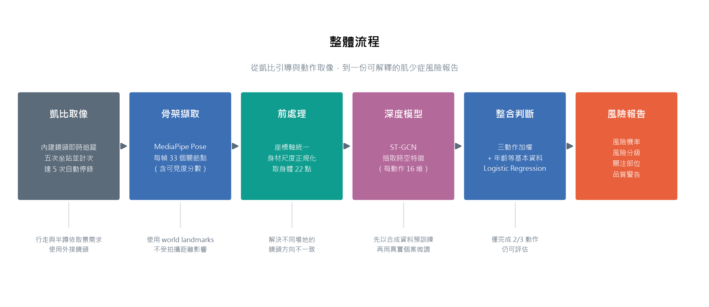
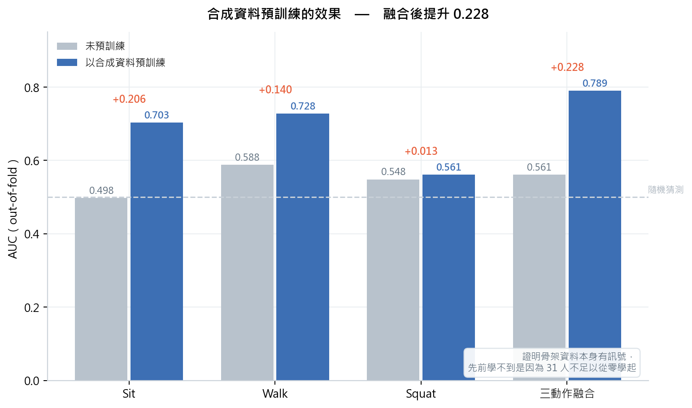
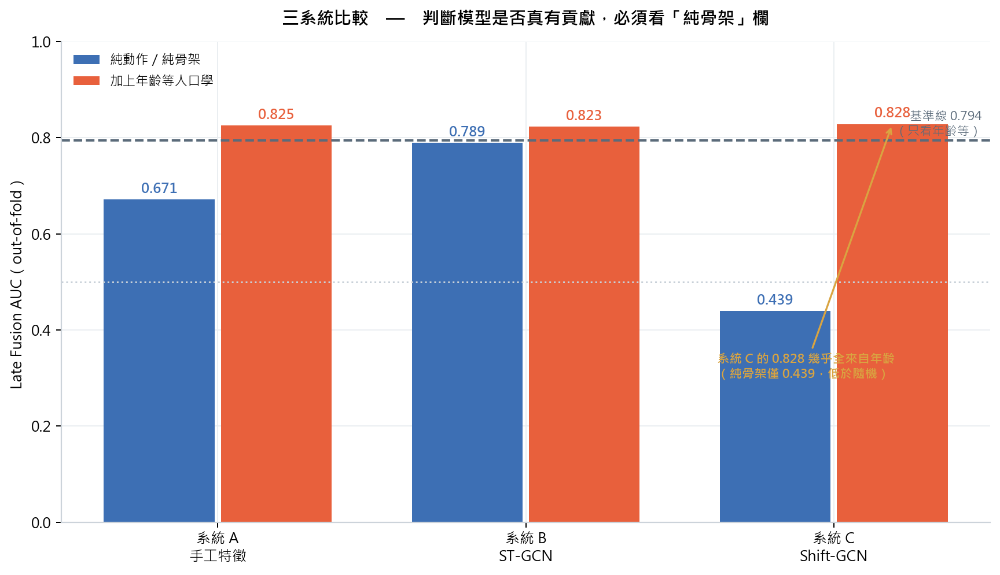

# 肌少症骨架分析與機器人輔助篩檢系統

**一支攝影機＋凱比機器人，引導長者完成三項功能動作，以骨架時序模型評估肌少症風險；資料不可靠時，系統會停下而不是硬給答案。**

> 這是公開展示版：保留完整程式碼、實驗結果與圖表，**不含任何受試者資料，也不含以受試者資料訓練的模型檔**。

▶ 成果展示影片：<https://www.youtube.com/watch?v=rb8xDGTuHp0>

---

## 一分鐘看懂

| 指標 | 結果 | 說明 |
|---|---|---|
| 純骨架模型 AUC | **0.789** | 不使用年齡等人口學資料，只看動作 |
| 敏感度／特異度 | **0.750／0.895** | 篩檢優先「少漏掉高風險者」 |
| 合成資料預訓練 | **AUC +0.228** | 0.561 → 0.789，小樣本下的關鍵 |
| 一輪檢測時間 | **約 4 分鐘** | 凱比引導三項動作，自動計次與停止 |
| 推論成本 | **一般筆電、不需獨立顯卡** | ST-GCN 推論不到 1 秒 |

**競賽成果**：2025 輔英全國健康智慧科技創新創業競賽 優異獎；2026 桃園新創之星 × 創天下 生醫科技與健康福祉組 決賽入圍；2026 新竹縣智慧沙盒創新計畫 學生組 決選入圍。

---

## 系統流程



1. **凱比機器人**負責迎賓、QR Code 報到、語音引導與結果呈現。
2. **C922 攝影機**錄製五次起立坐下、行走、半蹲三項動作。
3. **電腦端**以 MediaPipe 擷取骨架，三項動作各由一個 ST-GCN 評估，再以晚期融合輸出風險。
4. **安全把關**：資料品質不足、超出適用年齡或分析失敗時，不輸出風險等級。

---

## 研究設計

| 項目 | 設定 |
|---|---|
| 真實受試者 | 31 位（陽性 12／陰性 19），共 92 段動作 |
| 標籤 | 物理治療師依 AWGS 2019 準則判定 |
| 合成受試者 | 58 位，**只用於預訓練**，不參與任何評估 |
| 驗證方式 | 以**受試者**為單位的 5 折交叉驗證，避免同一人同時出現在訓練與測試 |
| 主要指標 | 收齊全部受試者 out-of-fold 預測後計算的 AUC，bootstrap 2,000 次估 95% 信賴區間 |

### 主要結果

| 模型設定 | AUC | 解讀 |
|---|---|---|
| 只看人口學資料（年齡、BMI 等） | 0.794 | 基準線：陽性組平均年長 13 歲 |
| ST-GCN 無預訓練・純骨架 | 0.561 | 31 位受試者不足以從零學習 |
| **ST-GCN 合成預訓練・純骨架** | **0.789** | **正式上線版本**：完全來自動作 |
| ST-GCN 合成預訓練・骨架＋人口學 | 0.823 | 最高，但敏感度降為 0.545 |



完整數據見 [RESULTS.md](RESULTS.md)，20 張圖表索引見 [figures/README.md](figures/README.md)。

---

## 研究嚴謹度：先確認分數是真的

- **抓出資料洩漏**：首次結果因早停使用了外層驗證集而虛高 0.34，改為在訓練折內部切分後修正。
- **處理年齡混淆**：設計「人口學／純動作／合併」三組特徵消融，確認骨架本身確有訊號，而不是模型在偷看年齡。
- **避免錯誤結論**：Shift-GCN 合併後 0.828 看似最高，但純骨架僅 0.439，分數幾乎全部來自人口學，因此不採用。
- **誠實呈現限制**：合併模型的 95% 信賴區間為 [0.64, 0.95]，與人口學基準在統計上無法區分，本研究定位為**可行性研究**。



開發過程中的每個錯誤與決策理由，都記錄在 [DEVELOPMENT_LOG.md](DEVELOPMENT_LOG.md)。

---

## 安全設計：不確定時停下

| 情境 | 系統行為 |
|---|---|
| 平均關節可見度 < 0.80，或下半身不可見影格 > 20% | 標示「結果不確定」並建議重拍 |
| 風險落在 35%–70% 灰色區間 | 不給明確等級，建議由專業人員評估 |
| 未滿 60 歲（AWGS 2019 適用年齡外） | 不顯示風險分數，只提供一般衛教 |
| 上傳、骨架擷取或模型失敗 | 一律顯示「無法評估」，**絕不以「低風險」代替** |

實機測試曾發現一段行走影片有 28.9% 影格下半身出鏡卻未被警示，因此加入出鏡比例檢查。

---

## 團隊

長庚大學人工智慧學系 專題團隊「長庚四天王」：張喬翔、彭冠維、陳威誠、翁宇陽

- **指導老師**：楊智淵
- **臨床合作**：長庚大學物理治療 林佩欣教授團隊（收案流程、動作項目與標記方式共同討論訂定）
- **贊助**：宏碁智醫

**陳威誠（本 repo 維護者）負責模型訓練與資料分析**：建立手工特徵、ST-GCN、Shift-GCN 三系統比較框架，設計受試者分組驗證，導入合成資料預訓練，完成動作消融與錯誤個案分析；並提出以凱比機器人承接篩檢引導的方向。

---

## 資料與倫理

- 受試者資料由物理治療師於長照機構收案；本研究成果屬可行性研究，**IRB 申請中**，正式擴大收案將於核准後進行。
- 本公開版**不收錄**任何影片、骨架、名冊、標籤或以受試者資料訓練的模型檔；結果檔中的逐人預測也已移除。
- 本系統為研究原型，輸出為初步篩檢參考，**不是醫療診斷**。

---

## 程式結構

```
src/                 資料名冊、骨架前處理、三系統模型、訓練、推論、圖表產生器
api_server.py        FastAPI 伺服器（上傳、評估、專業判讀分流）
static/              凱比端檢測頁、電腦控制台、動作就緒與坐站計次狀態機
tests/               Python 單元測試與前端流程回歸測試
results/             三系統與消融實驗的彙總結果
figures/             20 張實驗圖表與索引（逐人預測圖不公開）
docs/                API 規格、展場操作手冊、開發者指南
```

環境設定與執行方式見 [docs/DEVELOPER_GUIDE.md](docs/DEVELOPER_GUIDE.md)。MediaPipe 姿態模型 `pose_landmarker_heavy.task` 請自 [MediaPipe 官方頁面](https://ai.google.dev/edge/mediapipe/solutions/vision/pose_landmarker) 下載後放在專案根目錄。
